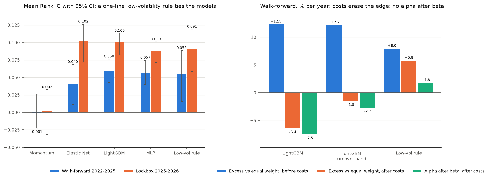

# VN-Rank: cross-sectional stock ranking on the Vietnamese market

[](https://github.com/gauronaldo/VN-Rank-Cross-Sectional-Stock-Ranking-on-the-Vietnamese-Market/actions/workflows/check.yml)

> **Can past prices and trading volume tell which Vietnamese stocks will do better over the
> next week, and is that enough to make money after trading costs?**
>
> 1. **Ranking:** does the model's ranking match next week's actual ranking? **Yes.**
> 2. **Profit:** does buying the top-ranked stocks beat buying all of them, after costs? **Not yet.**

## The answer

- **The ranking is real.** The pre-registered primary model, LightGBM, has a mean Rank IC
  of **0.058** on four years of walk-forward tests (95% CI 0.042 to 0.076, positive in 8 of
  8 folds) and **0.100** on a held-out year evaluated once (CI 0.082 to 0.113). Both
  pre-registered criteria hold.
- **It is mostly the low-volatility effect.** A one-line rule (rank stocks by minus their
  60-day volatility) reaches 0.055. The models are steadier than the rule, not stronger.
- **It does not pay after costs.** Before costs the top decile beats the equal-weight
  portfolio by about 12% a year, but the ranking changes fast: about 65% of the portfolio is
  replaced every week, costs take about 20% a year, and no strategy keeps a positive alpha
  after costs and after adjusting for beta. The ranking is best at spotting losers, which a
  long-only portfolio (no short selling in Vietnam) cannot use.



The value of the project is the protocol that makes this answer trustworthy: no look-ahead,
no tuning on test data, and a lockbox opened exactly once.

## Method

- **Data:** `vnstock` (source `vci`), daily prices adjusted for corporate actions,
  2018-11 → 2026-11, 1,755 listed symbols **including 239 delisted ones** to reduce
  survivorship bias; 1,720 have data ([data quality](reports/data_quality.md)).
- **Universe:** each day, stocks with 252 sessions of history and a 60-session median traded
  value of at least 1 billion VND (about 320 stocks), using only information up to that day.
- **Features:** 15 hand-written price–volume indicators in 5 groups, each ranked within its
  day. **Label:** the rank of the return from the next close to 5 sessions later.
- **Validation:** 8 expanding walk-forward folds (half-year test blocks, 2022-01 → 2025-09),
  purged on the label exit date plus a 10-session embargo; Optuna tunes only on the last 6
  months of each training window. A test rebuilds features on truncated data to prove
  there is no look-ahead.
- **Lockbox:** 2025-10 → 2026-10, evaluated **once** at the end; a committed lock file
  ([`reports/lockbox_run.lock`](reports/lockbox_run.lock)) prevents a second run.
- **Portfolio:** long-only top decile (about 32 stocks), equal weight, rebalanced every 5
  sessions, net of 0.15% brokerage and 0.10% slippage per side plus the 0.1% selling tax,
  with limit-up/limit-down and liquidity constraints.

The criteria, models, and metrics were fixed before any result
([`docs/protocol.md`](docs/protocol.md), with a dated changelog); the reason for every
choice is in [`docs/design_notes.md`](docs/design_notes.md).

## Results

**Signal (walk-forward, 925 test dates).**

| Model | Mean Rank IC [95% CI] | Folds > 0 | LightGBM minus model [95% CI] |
|---|---|---|---|
| Momentum (20 d) | -0.001 [-0.023, 0.026] | 4 / 8 | 0.059 [0.034, 0.080] |
| Reversal (5 d) | 0.005 [-0.015, 0.023] | 5 / 8 | 0.054 [0.027, 0.084] |
| Elastic Net | 0.040 [0.011, 0.069] | 6 / 8 | 0.018 [-0.001, 0.040] |
| **LightGBM** (primary) | **0.058 [0.042, 0.076]** | **8 / 8** | — |
| MLP | 0.057 [0.040, 0.075] | 8 / 8 | 0.002 [-0.006, 0.010] |
| Low-volatility rule* | 0.055 [0.015, 0.088] | 7 / 8 | 0.003 [-0.020, 0.034] |

**Portfolio (walk-forward, % per year, net of costs unless stated).**

| Strategy | Turnover | Cost | Excess vs equal weight, before costs | Excess vs equal weight [95% CI] | Beta | Alpha after beta [95% CI] |
|---|---|---|---|---|---|---|
| LightGBM top decile | 33x | 19.9 | +12.3 | -6.4 [-19.1, +7.8] | 0.83 | -7.5 [-17.3, +4.5] |
| LightGBM, turnover band* | 25x | 14.8 | +12.2 | -1.5 [-14.2, +12.9] | 0.82 | -2.7 [-12.5, +9.4] |
| Low-volatility rule* | 5x | 3.3 | +8.0 | +5.8 [-18.5, +27.1] | 0.35 | +1.8 [-7.9, +10.2] |

**Lockbox (2025-10 → 2026-10).** LightGBM 0.100, Elastic Net 0.102, MLP 0.089, the
low-volatility rule 0.091, baselines about 0. Before reporting, the high value was checked
for leakage: the rebuilt panel matches the development panel exactly, the ATR rank alone
(past prices only) reaches -0.104, and Rank IC is positive in all 13 months. The year
favoured low-volatility stocks (the equal-weight portfolio lost about 22% a year while
VNINDEX gained about 5% a year), so the walk-forward 0.058 is the more representative
estimate.

\*Added after seeing results and labelled as such: the turnover band (keep holdings while
in the top 20%) after the walk-forward backtest, and the low-volatility rule after the
lockbox. Neither changes a pre-registered result.

**Also tested:** dropping any one feature group changes Rank IC by at most 0.005 (not
significant); Rank IC falls from 0.070 to 0.045 as the liquidity threshold rises from 0.5
to 5 billion VND; net excess return breaks even near 0.15% fee plus slippage per side.

**Exploratory extension (pre-registered before any code, walk-forward only).** Four
features from the anomaly literature (beta, idiosyncratic volatility, maximum daily
return, skewness) **raise LightGBM's Rank IC from 0.058 to 0.068** (difference +0.010, CI
+0.003 to +0.017); XGBoost gives the same result as LightGBM (difference 0.000). The
extended model still does not beat the low-volatility rule significantly (+0.013, CI
-0.014 to +0.048), and a one-line idiosyncratic-volatility rule reaches 0.071 with the
best net result (+10.2% a year over equal weight; alpha after beta +6.7%, CI -1.6 to
+14.4), reported without a claim. See the
[extension report](reports/extension_features_xgboost.md).

Detailed reports: [signal](reports/signal_results.md) ·
[backtest](reports/backtest_results.md) · [lockbox](reports/lockbox_results.md) ·
[ablation and SHAP](reports/ablation_results.md) ·
[low-volatility comparison](reports/exploratory_low_volatility.md) ·
[equity curves](reports/equity_curves.png) · [monitoring](reports/realized_ic.png)

## Metric definitions

- **Rank IC:** on one day, the Spearman correlation between model scores and realized 5-day
  returns across the stocks; a day with identical scores counts as 0. IC IR (mean / std of
  the daily series) is per day, not annualized.
- **Intervals:** 95% moving-block bootstrap (20-day blocks, 10,000 resamples) of daily
  series; paired for differences. Newey-West t-statistics use lag 4 for overlapping labels.
- **Returns:** daily net returns, annualized as mean × 252; Sharpe uses a 0% risk-free
  rate. Turnover is one-way per rebalance, annualized. Alpha and beta come from regressing
  daily returns on the equal-weight benchmark.

## Limitations

- **Survivorship bias is reduced, not removed:** 25 delisted symbols cannot be served by
  the source, and older delistings are absent.
- **Short history:** 3.75 years of walk-forward and 1 lockbox year, so portfolio results
  carry wide intervals (the standard error of an annual Sharpe is about 0.6).
- **Simplified execution:** trades at the close, fixed slippage, and today's exchange (and
  price band) for every date.
- **Weak pre-registered baselines and no beta adjustment** in the original design; both
  were added afterwards as exploratory checks.

## Reproduction

```bash
make setup      # pinned dependencies (uv) and git hooks
make check      # ruff, mypy --strict, pytest (198 tests; also run in CI)
make download   # vnstock snapshot (free Community API key)
make features   # development panel, about 1 minute
make train      # walk-forward tuning and scoring of 5 models, about 40 minutes
make backtest   # portfolio backtest, about 1 minute
make ablation   # feature groups, sensitivity, SHAP, about 25 minutes
make update     # score the newest session with the frozen model
```

Every run is logged to MLflow; 2,730 configurations were tried in total. Without access to
the vnstock vendor index, `uv sync --no-group data` installs everything except the
downloader. On Windows without `make`, run `uv run vn-rank <command>`.

## Repository map

```
configs/default.yaml   every tunable value
src/vn_rank/           data, features, validation, models, evaluation, backtest, monitoring
tests/                 look-ahead, purge, and cost-accounting tests among 198
docs/                  protocol.md (pre-registered), design_notes.md
reports/               every table and figure referenced above
```
