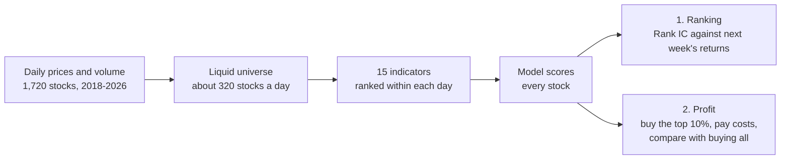

# VN-Rank: cross-sectional stock ranking on the Vietnamese market

[](https://github.com/gauronaldo/VN-Rank-Cross-Sectional-Stock-Ranking-on-the-Vietnamese-Market/actions/workflows/check.yml)

> **Can past prices and trading volume tell which Vietnamese stocks will do better over the
> next week, and is that enough to make money after trading costs?**
>
> 1. **Ranking:** does the model's ranking match next week's actual ranking? **Yes.**
> 2. **Profit:** does buying the top-ranked stocks beat buying all of them, after costs? **Not shown.**

| At a glance | |
|---|---|
| **Data** | Daily prices and volume of 1,720 stocks (239 delisted ones included), 2018–2026; about 320 liquid stocks a day |
| **Method** | 15 hand-written price–volume indicators → Elastic Net, LightGBM, and an MLP, against one-line rules; 8 walk-forward half-years, then one held-out year |
| **Result** | The ranking works (Rank IC 0.058, 95% CI 0.042–0.076); a profit after costs is not shown |
| **Rigor** | Protocol locked before results, purge and embargo, held-out year evaluated once for the fixed models, block-bootstrap intervals, look-ahead tests |

The value of the project is the testing, not a trading strategy: the answer on profit is
negative, but it was reached under rules fixed in advance, with no look-ahead and no tuning
on test data, so it can be trusted.

## The answer

- **The ranking is real.** LightGBM, the primary model fixed in advance, has a mean Rank IC
  of **0.058** on 3.75 years of walk-forward tests (positive in 8 of 8 folds) and **0.100**
  on the held-out year (CI 0.082 to 0.113). Both success criteria fixed in advance hold.
  *Rank IC is the daily correlation between predicted and realized ranks (0 = chance; 0.02
  to 0.05 is typically useful).*
- **It is mostly the low-volatility effect.** A one-line rule (rank stocks by minus their
  60-day volatility) reaches 0.055. The models are steadier than the rule, not stronger.
- **A profit after costs is not shown.** Before costs the top decile beats the equal-weight
  portfolio by about 12% a year, but about 65% of the portfolio is replaced every week and
  costs take about 20% a year. No strategy has an alpha after costs and beta that is
  significantly above zero (the low-volatility rule's +1.8% a year has an interval that
  includes 0). The ranking is best at spotting losers, which a long-only
  portfolio (no short selling in Vietnam) cannot use.


## Method



Every step uses only data available on the day; the whole chain is refit and tested on 8
walk-forward half-years, then run once on the held-out year.

- **Data:** `vnstock` (source `vci`), daily prices adjusted for corporate actions,
  2018-11 → 2026-11, 1,755 listed symbols **including 239 delisted ones** to reduce
  survivorship bias; 1,720 have data ([data quality](reports/1_data/data_quality.md)).
- **Universe:** each day, stocks with 252 sessions of history and a 60-session median traded
  value of at least 1 billion VND (about 320 stocks), using only information up to that day.
- **Features:** 15 hand-written price–volume indicators in 5 groups, each ranked within its
  day. **Label:** the rank of the return from the next close to 5 sessions later.
- **Validation:** 8 expanding walk-forward folds (half-year test blocks, 2022-01 → 2025-09),
  purged on the label exit date plus a 10-session embargo; Optuna tunes only on the last 6
  months of each training window. A test rebuilds features on truncated data to prove
  there is no look-ahead.
- **Lockbox:** 2025-10 → 2026-10. The models fixed in advance were evaluated on it
  **once**, at the end; a committed lock file
  ([`lockbox_run.lock`](reports/4_lockbox/lockbox_run.lock)) prevents a second run. Rules
  added later were scored on it descriptively only, so the lockbox is now spent.
- **Portfolio:** long-only top decile (about 32 stocks), equal weight, rebalanced every 5
  sessions, net of 0.15% brokerage and 0.10% slippage per side plus the 0.1% selling tax,
  with limit-up/limit-down and liquidity constraints.

The criteria, models, and metrics were fixed before any result
([`docs/protocol.md`](docs/protocol.md), with a [dated changelog](docs/protocol_changelog.md)). The protocol was
committed to this repository, not registered with an outside service, so the git history
is its only timestamp; the reason for every
choice is in [`docs/design_notes.md`](docs/design_notes.md).

## Results

| Walk-forward, 2022-01 → 2025-09 | Mean Rank IC [95% CI] | Net excess over equal weight, % a year [95% CI] |
|---|---|---|
| **LightGBM** (primary) | **0.058 [0.042, 0.076]** | -6.4 [-19.1, +7.8] |
| Low-volatility rule* | 0.055 [0.015, 0.088] | +5.8 [-18.5, +27.1] |
| Momentum (20 d) baseline | -0.001 [-0.023, 0.026] | -4.8 [-19.6, +11.7] |
| Reversal (5 d) baseline | 0.005 [-0.015, 0.023] | -53.4 [-67.6, -39.9] |

MLP (0.057) matches LightGBM and Elastic Net (0.040) trails it. All models, turnover,
costs, beta, and alpha are in the [full tables](reports/README.md#headline-tables), with
the [metric definitions](reports/README.md#metric-definitions).

**Lockbox (2025-10 → 2026-10).** LightGBM 0.100, Elastic Net 0.102, MLP 0.089,
baselines about 0 (the low-volatility rule*, scored there afterwards, 0.091). Before
reporting, the high value was checked for leakage: the rebuilt panel matches the
development panel exactly, the ATR rank alone (past prices only) reaches -0.104, and Rank
IC is positive in all 13 months. The year favoured low-volatility stocks (the equal-weight
portfolio lost about 22% a year while VNINDEX gained about 5% a year), so the walk-forward
0.058 is the more representative estimate.

\*Added after the lockbox and labelled exploratory; it changes no result fixed in advance.

**After the lockbox** ([exploratory analyses](docs/exploratory.md)): four features from
the anomaly literature raise Rank IC to 0.068 but do not beat the low-volatility rule
significantly, and XGBoost makes no difference. Putting back the 26 test labels lost to delistings
changes Rank IC by at most 0.0003 and LightGBM's net excess return by 0.1 to 3 points a
year (see the limitations).

## Limitations

- **Survivorship bias is reduced, not removed:** 25 delisted symbols cannot be served by
  the source, and older delistings are absent.
- **Short history:** 3.75 years of walk-forward and 1 lockbox year, so portfolio results
  carry wide intervals (the standard error of an annual Sharpe is about 0.6).
- **Simplified execution:** trades at the close, fixed slippage, and today's exchange (and
  price band) for every date.
- **A small look-ahead in the backtest:** it chooses only among stocks whose 5-day label
  exists, so it never buys a stock that stops trading during the hold. Letting it buy them
  (4 rebalance rows) lowers LightGBM's net excess return from -6.4% to -6.6% a year if
  they are carried at their last price, and to -9.4% if they are a total loss
  ([check](docs/exploratory.md#3-labels-lost-to-delisting)). The conclusion does not change.
- **Weak baselines and no beta adjustment** in the original design; both
  were added afterwards as exploratory checks.

## Reproduction

```bash
make setup      # pinned dependencies (uv) and git hooks
make check      # ruff, mypy --strict, pytest (also run in CI)
make download   # vnstock snapshot (free Community API key)
make features   # development panel, about 1 minute
make train      # walk-forward tuning and scoring of 5 models, about 40 minutes
make backtest   # portfolio backtest, about 1 minute
make ablation   # feature groups, sensitivity, SHAP, about 25 minutes
make update     # score the newest session with the frozen model
make exploratory delisting   # post-lockbox checks (docs/exploratory.md)
```

**Data snapshot:** downloaded 2026-11-07 with vnstock 5.2.2 (source `vci`), sessions
2018-11-01 → 2026-11-06. The data are not committed (vendor licence), and the vendor
adjusts prices for corporate actions and may revise them, so a new download can differ.
`make features` logs the development panel's content hash; for this snapshot it is
`6286af4f79be7b62800c20b6f8fa5a859be4dfba6c8c1d26f8ed45bce81c6093` (449,922 rows). A
different hash means different data, and the numbers above will not match exactly.

Every run is logged to MLflow; 3,450 configurations were tried in total. Without access to
the vnstock vendor index, `uv sync --no-group data` installs everything except the
downloader. On Windows without `make`, run `uv run vn-rank <command>`.

## Repository map

```
configs/default.yaml   every tunable value
src/vn_rank/           data, features, validation, models, evaluation, backtest, monitoring
tests/                 includes look-ahead, purge, and cost-accounting tests
docs/                  protocol.md (locked before results) and its changelog, design_notes.md, exploratory.md
notebooks/01_eda.ipynb universe size, missing values, feature distributions and correlations
reports/               every table and figure, one folder per stage (see reports/README.md)
```
