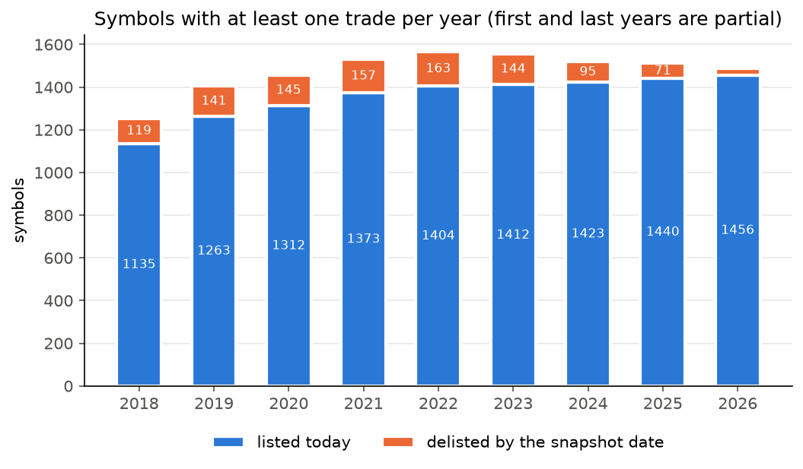
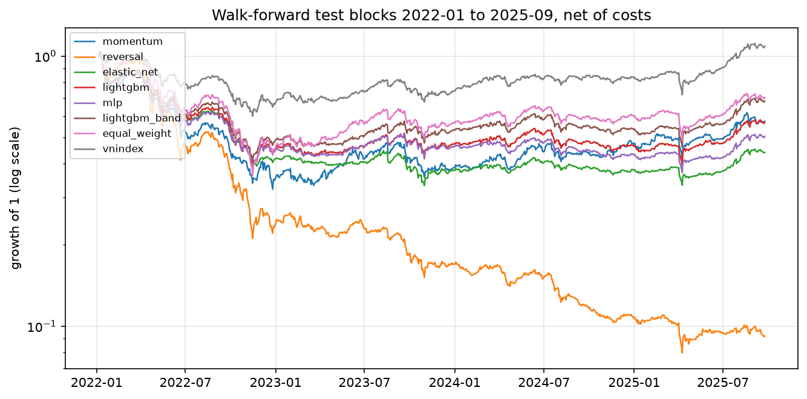
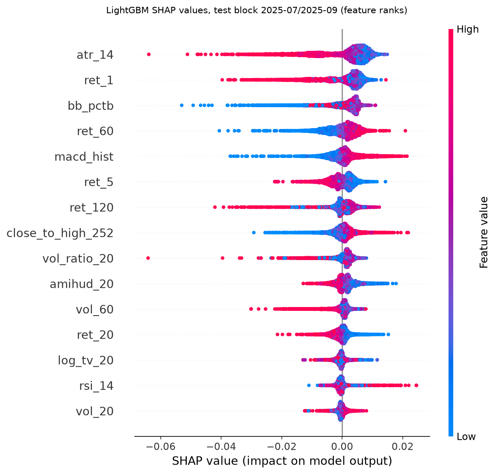
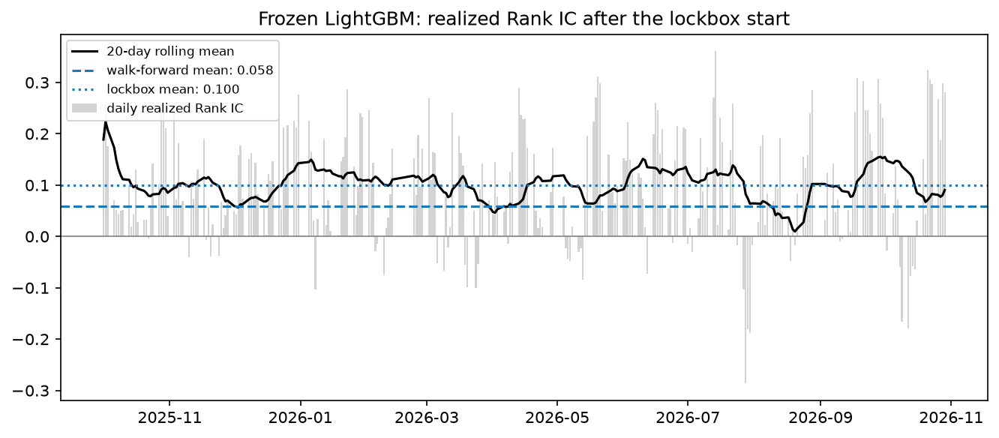

# VN-Rank: cross-sectional stock ranking on the Vietnamese market

> **Research question:** can price–volume features rank Vietnamese stocks by 5-day forward
> return, net of trading costs?

VN-Rank ranks the liquid Vietnamese stocks every day by expected relative performance
over the next 5 trading days. It does not forecast prices or call market direction.
Success is measured by **Rank IC** (defined below) under a pre-registered protocol, and by
whether a long-only portfolio built from the ranking survives trading costs.

## Answer in short

- **The ranking is real.** The pre-registered primary model (LightGBM) has a walk-forward
  mean Rank IC of **0.058** (95% block-bootstrap CI 0.042 to 0.076, positive in 8 of 8
  folds) and **0.100** on the untouched lockbox year (CI 0.082 to 0.113). Both
  pre-registered criteria hold: the outcome is **Supported**.
- **It is not yet a profitable strategy.** Before costs the top decile beats the
  equal-weight portfolio of the same universe by about 12% a year on walk-forward. But
  the ranking changes fast (about 65% of the portfolio is replaced every week), so
  realistic costs of about 0.6% per round trip take about 20% a year, and the net excess
  return is **-6.4% a year** (CI -19% to +8%). In the lockbox year it is +6.6% a year,
  but the CI again includes zero, and the absolute return is negative because the whole
  universe fell.
- **Where the signal comes from.** Mostly a low-volatility and liquidity tilt. An
  exploratory check after the lockbox shows that the textbook low-volatility rule (rank
  stocks by minus their 60-day volatility) matches LightGBM's mean Rank IC (0.055 vs
  0.058, difference not significant); LightGBM's signal is steadier, not stronger. The
  ranking is strongest at telling which stocks will do worst, which a long-only portfolio
  in Vietnam (no short selling) cannot exploit.
- **No strategy shows alpha after costs.** The low-volatility portfolio trades 6 times
  less and beats equal weight by 5.8% a year, but its beta is only 0.35; after adjusting
  for beta its alpha is +1.8% a year (CI -7.9% to +10.2%). No strategy here has a
  significantly positive beta-adjusted alpha net of costs.

## Data

- `vnstock` 5.2.2, Community tier, source `vci` only: daily OHLCV adjusted for corporate
  actions, in thousand VND, plus VNINDEX. Snapshot 2018-11-01 → 2026-11-06, downloaded
  2026-11-07: 1,755 symbols (HOSE 408, HNX 299, UPCoM 809, delisted 239), of which 1,720
  have data. See [`reports/data_quality.md`](reports/data_quality.md).
- **Delisted symbols are included** to reduce survivorship bias, but symbols that left
  the market before the vendor's list was compiled are still missing.
  
- Raw data is never committed (vnstock licence).

## Protocol

The full pre-registered protocol, locked on 2026-11-06 with a dated changelog, is in
[`docs/protocol.md`](docs/protocol.md); the reason for every choice is in
[`docs/design_notes.md`](docs/design_notes.md).

| Item | Choice |
|---|---|
| Universe (point-in-time) | 252 sessions of history, 60-session median traded value ≥ 1 billion VND, traded on the day; about 320 stocks per day; dates with fewer than 50 stocks dropped |
| Features | 15 hand-written price–volume features in 5 groups (momentum, volatility, technical, liquidity, price position), each ranked within its date |
| Label | signal at the close of `t`, entry at the close of `t + 1`, exit 5 sessions later; target = per-date rank of the forward return |
| Validation | 8 expanding walk-forward folds with half-year test blocks, 2022-01 → 2025-09; purge on the label exit date plus a 10-session embargo; tuning (Optuna) only on the last 6 months of each training window |
| Lockbox | 2025-10-01 → 2026-10-29 (269 signal dates), evaluated **once** behind a guard and a committed lock file |
| Models | 20-day momentum and 5-day reversal baselines, Elastic Net, **LightGBM (primary, chosen before any result)**, MLP; LightGBM and MLP averaged over 5 seeds |
| Portfolio | long-only top decile (about 32 stocks), equal weight, rebalanced every 5 sessions; brokerage 0.15% and slippage 0.10% per side, 0.1% selling tax; no buying at limit-up, no selling at limit-down, positions capped at 10% of 20-day traded value for a 10 billion VND portfolio |

**Pre-registered criteria (LightGBM only).** C1: the lower bound of the 95% CI of the
walk-forward mean Rank IC is above 0. C2: the lockbox mean Rank IC is above 0. A leakage
tripwire stops work if a walk-forward mean Rank IC exceeds 0.10 or a fold exceeds 0.20.

## Results

### Signal level: walk-forward (925 test dates)

| Model | Mean Rank IC [95% CI] | IC IR | NW t | Folds > 0 | LightGBM minus model [95% CI] |
|---|---|---|---|---|---|
| Momentum (20 d) | -0.001 [-0.023, 0.026] | -0.003 | -0.05 | 4 / 8 | 0.059 [0.034, 0.080] |
| Reversal (5 d) | 0.005 [-0.015, 0.023] | 0.026 | 0.49 | 5 / 8 | 0.054 [0.027, 0.084] |
| Elastic Net | 0.040 [0.011, 0.069] | 0.197 | 3.26 | 6 / 8 | 0.018 [-0.001, 0.040] |
| **LightGBM** | **0.058 [0.042, 0.076]** | **0.433** | **7.51** | **8 / 8** | — |
| MLP | 0.057 [0.040, 0.075] | 0.392 | 6.85 | 8 / 8 | 0.002 [-0.006, 0.010] |

LightGBM beats both baselines clearly; its lead over Elastic Net and the MLP is not
significant. The seed standard deviation of mean Rank IC is 0.0009 (LightGBM) and 0.0016
(MLP). Per fold, LightGBM ranges from 0.011 (2023H1) to 0.101 (2024H1). Full tables:
[`reports/signal_results.md`](reports/signal_results.md).

### Portfolio level: walk-forward, net of costs

| Strategy | Ann. return | Sharpe [95% CI] | Max DD | Turnover / yr | Cost / yr | Excess vs EW before costs | Excess vs EW after costs [95% CI] |
|---|---|---|---|---|---|---|---|
| LightGBM top decile | -12.6% | -0.54 [-1.47, 0.72] | -63% | 33.0x | 19.9% | +12.3% | -6.4% [-19.1%, +7.8%] |
| LightGBM, turnover band* | -7.7% | -0.33 [-1.29, 0.98] | -61% | 24.5x | 14.8% | +12.2% | -1.5% [-14.2%, +12.9%] |
| MLP top decile | -16.1% | -0.72 [-1.63, 0.55] | -64% | 33.2x | 20.0% | +9.0% | -9.9% [-21.9%, +4.1%] |
| Momentum top decile | -11.0% | -0.39 [-1.36, 0.89] | -69% | 21.4x | 12.9% | +7.0% | -4.8% [-19.6%, +11.7%] |
| Equal weight (same universe) | -6.2% | -0.24 [-1.30, 1.16] | -65% | 1.7x | 1.1% | — | — |
| VNINDEX (no costs) | +4.2% | 0.22 [-0.78, 1.43] | -40% | — | — | — | — |

\*Secondary variant (AGENT.md 3.7): keep a holding while it ranks in the top 20%, fill
vacated slots from the top decile. It was added **after** seeing the walk-forward
turnover; the band is the specification's value, not tuned.

The test period starts at the top of the 2022 market: equal weight lost 55% in 2022
(VNINDEX -34%). Per-year returns:
[`reports/backtest_results.md`](reports/backtest_results.md).



### Lockbox (2025-10 → 2026-10, run once on 2026-11-07)

| Model | Mean Rank IC [95% CI] | NW t | Excess vs EW after costs [95% CI] |
|---|---|---|---|
| **LightGBM** | **0.100 [0.082, 0.113]** | 9.43 | +6.6% [-3.8%, +16.8%] |
| LightGBM, turnover band* | — | — | +10.8% [-0.2%, +22.4%] |
| Elastic Net | 0.102 [0.072, 0.126] | 6.52 | +15.7% [+2.8%, +27.9%] |
| MLP | 0.089 [0.072, 0.101] | 8.60 | +7.9% [-0.9%, +14.5%] |
| Momentum / Reversal | 0.002 / 0.003 | 0.10 / 0.18 | -17.0% / -33.6% |

Lockbox Rank IC is higher than walk-forward. Before reporting it, it was checked for
leakage. The full panel reproduces the development panel exactly on development dates,
the ATR rank alone (past prices only) reaches -0.104, a linear model matches LightGBM,
and Rank IC is positive in all 13 months. The period favoured low-volatility stocks: the
average stock fell (equal weight -22% a year) while large caps held VNINDEX at +4.7% a
year. So every long-only portfolio here lost money in absolute terms, and the
walk-forward 0.058 is the more representative estimate. Report:
[`reports/lockbox_results.md`](reports/lockbox_results.md).

### Ablation, sensitivity, and explanation

- **Feature groups** (LightGBM rerun without each group, unchanged protocol): no group is
  indispensable. The largest falls are without momentum (-0.005) and without technical
  indicators (-0.004), and every paired CI includes zero. The features overlap heavily
  (for example ATR, volatility, and Amihud illiquidity).
- **Liquidity threshold:** Rank IC is 0.070 at 0.5, 0.058 at 1, 0.057 at 2, and 0.045 at
  5 billion VND. The signal is strongest where trading is hardest. Net excess return is
  negative at every threshold.
- **Costs:** net excess return over equal weight breaks even at about 0.15% fee plus
  slippage per side (about 0.4% per round trip with the tax); the default is 0.25%.
- **SHAP** (last fold): high ATR, high 1-day return, and low Bollinger %B lower the
  score; high 60-day return, MACD, and closeness to the 252-day high raise it.

Tables: [`reports/ablation_results.md`](reports/ablation_results.md).



### Exploratory: does LightGBM beat a one-line low-volatility rule?

Run **after** the lockbox (`vn-rank exploratory`), so it changes no pre-registered result.
`lowvol_vol60` scores a stock by minus its 60-day volatility rank (the textbook rule);
`lowvol_atr14` uses ATR and was picked after seeing the test blocks, so it is optimistic.
Same rows, engine, costs, and benchmark as LightGBM; alpha is net of costs after
adjusting for beta to the equal-weight benchmark.

| Walk-forward | Mean Rank IC [95% CI] | LightGBM minus rule | Turnover / yr | Excess vs EW | Beta | Alpha after beta [95% CI] |
|---|---|---|---|---|---|---|
| LightGBM | 0.058 [0.042, 0.076] | — | 33.0x | -6.4% | 0.83 | -7.5% [-17.3%, +4.5%] |
| LightGBM, turnover band* | — | — | 24.5x | -1.5% | 0.82 | -2.7% [-12.5%, +9.4%] |
| Low volatility (60-day) | 0.055 [0.015, 0.088] | +0.003 [-0.020, 0.034] | 5.3x | +5.8% | 0.35 | +1.8% [-7.9%, +10.2%] |
| Low volatility (ATR, post hoc) | 0.061 [0.021, 0.095] | -0.003 [-0.026, 0.029] | 7.4x | +5.7% | 0.34 | +1.6% [-6.2%, +9.0%] |

On the lockbox the picture is the same: the 60-day rule's Rank IC is 0.091 against
LightGBM's 0.100 (difference +0.009, CI -0.016 to 0.032), and no strategy's
beta-adjusted alpha has an interval above zero.

**Reading.** The machine-learning models do not rank better on average than the
low-volatility rule. Their advantage is stability: LightGBM's Rank IC interval is about
half as wide and positive in 8 of 8 folds (the rule: 7 of 8, from -0.026 to 0.125). The
low-volatility portfolio's raw excess return comes from a low beta in a falling market
(2022: -27% against -55% for equal weight), not from skill after adjusting for beta. A
stronger design would have pre-registered a low-volatility baseline and a beta-adjusted
excess return. Full tables:
[`reports/exploratory_low_volatility.md`](reports/exploratory_low_volatility.md).

### Monitoring

`vn-rank update` scores the newest session with the frozen lockbox model and tracks the
realized Rank IC once labels mature:



## Metric definitions

- **Rank IC ("IC" everywhere in this repository):** on one date, the Spearman correlation
  between model scores and realized 5-day forward returns across the scored stocks. A
  date on which a model gives every stock the same score counts as 0.
- **Mean Rank IC, IC IR:** the mean of the daily Rank IC series over the test dates; IC IR
  is mean / standard deviation, **per day, not annualized**.
- **NW t:** t-statistic of the mean Rank IC with Newey-West (Bartlett) standard errors,
  lag 4, because 5-day labels on consecutive days overlap.
- **Confidence intervals:** 95% moving-block bootstrap (20-day blocks, 10,000 resamples)
  of the daily series, percentile intervals; paired for differences.
- **Returns and Sharpe:** daily net returns; annualized return = mean × 252, volatility =
  standard deviation × √252, Sharpe = their ratio with a 0% risk-free rate. Turnover is
  one-way (half the sum of absolute weight changes) per rebalance, × 252 / 5 per year.
- For context only: public benchmarks on Chinese equities (Microsoft Qlib) report Rank IC
  of about 0.02–0.05. They use a different market, label, and cost model and are **not
  comparable**; they only show that a few hundredths is a normal result.

## Limitations

- **Survivorship bias** is reduced, not removed: 239 delisted symbols are included, but
  25 of them cannot be served by the source and earlier delistings are absent. A stock
  whose label is missing because it delisted inside the 5-day window is never selected,
  and a delisted holding is carried at its last price.
- **Adjusted prices:** historical traded values (used by the liquidity filter) are only
  approximate, and refreshing data needs a complete new snapshot.
- **Today's exchange for every date:** about 75 stocks moved exchange, so their price
  band, and the limit-lock constraint, is wrong before the move.
- **Short history:** about 3.75 years of walk-forward and 1 year of lockbox. The standard
  error of an annualized Sharpe is about 0.6 and 1.2 respectively, which is why Sharpe is
  secondary and every portfolio result carries a wide interval.
- **Costs and execution are simplified:** trades at the close, a fixed slippage, a
  limit-lock rule from the close-to-close return, and current fee and band rules.
- **Choices made after seeing results** are labelled: the turnover-band variant (after the
  walk-forward backtest) and the cost defaults (fixed before the backtest was run).
- **Weak pre-registered baselines:** momentum and reversal have no signal in this market,
  so beating them says little; the low-volatility comparison above was only added after
  the lockbox. Excess return over equal weight is not adjusted for beta, which flatters
  low-beta portfolios; the exploratory table adds the beta-adjusted alpha.
- **Inference may be optimistic:** the Newey-West lag (4) covers label overlap but not
  regime persistence. A cruder fold-level test (8 fold means of LightGBM Rank IC: mean
  0.059, standard deviation 0.028) still gives t of about 6.

## Reproduction

```bash
make setup             # pinned dependencies (uv) and git hooks
make check             # ruff, mypy --strict, pytest (198 tests)
make download          # vnstock snapshot into data/raw (Community API key required)
make validate-data     # data-quality report and tickers-per-year figure
make features          # development panel (prices before the lockbox), about 1 minute
make train             # walk-forward tuning and scoring of 5 models, about 40 minutes
make backtest          # portfolio backtest, about 1 minute
make ablation          # feature groups, liquidity and cost sensitivity, SHAP, about 25 minutes
make update            # score the newest session with the frozen model
make exploratory       # post-lockbox low-volatility comparison (exploratory)
```

`make lockbox` exists but refuses to run again: `reports/lockbox_run.lock` records the one
run (commit `60375ba`). Every run is logged to MLflow (`mlruns/mlflow.db`; browse with
`uv run mlflow ui --backend-store-uri sqlite:///mlruns/mlflow.db`). Configurations tried:
720 Optuna trials in walk-forward, 1,920 in the ablation, and 90 for the lockbox model.

On Windows without `make`, run the commands directly, for example
`uv run ruff check . && uv run ruff format --check . && uv run mypy && uv run pytest`
and `uv run vn-rank train`. `vnstock` comes from the vendor index (the `data` dependency
group); register a free Community key once with `vnstock register`. Without access to that
index, `uv sync --no-group data` installs everything except the downloader.

## Repository map

```
configs/default.yaml   every tunable value
src/vn_rank/
  data/                download, storage, validation, universe
  features/            indicators, ranks, labels, panel builder
  validation/          purged walk-forward splits, lockbox guard, walk-forward runner
  models/              baselines, Elastic Net, LightGBM, MLP, Optuna tuning
  evaluation/          Rank IC, performance, block bootstrap
  backtest/            costs, constraints, rebalance loop, runner
  monitoring/          frozen-model scoring and realized Rank IC
  cli.py, pipeline.py, ablation.py, final.py, exploratory.py   entry point and commands
tests/                 mirrors src/ (look-ahead, purge, and cost-accounting tests included)
docs/                  protocol.md (pre-registered), design_notes.md
notebooks/             EDA only
reports/               the tables and figures used in this README
```
