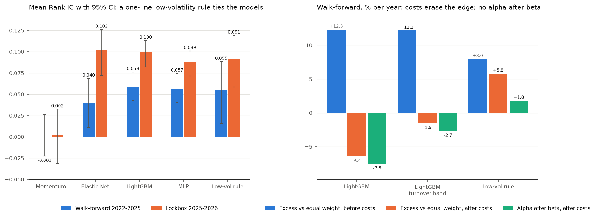

# Reports

Every table and figure in the project, one folder per stage, in the order the project ran.
Each file is written by the command named in its heading; the `.csv` files hold the same
numbers as the `.md` tables at full precision.

[`summary.png`](summary.png): the figure the main README opens with (Rank IC by model and
period, and the walk-forward cost story).

## [1. Data](1_data/) (`vn-rank validate-data`)

| File | What it shows |
|---|---|
| [data_quality.md](1_data/data_quality.md) | Snapshot coverage, excluded symbols, flags per data-quality check, and the largest price-band breaches |
| [tickers_per_year.png](1_data/tickers_per_year.png) | Listed and delisted symbols with data in each year |

## [2. Walk-forward](2_walk_forward/) (`vn-rank train`, `vn-rank backtest`)

The main development results: 8 test blocks, 2022-01 to 2025-09.

| File | What it shows |
|---|---|
| [signal_results.md](2_walk_forward/signal_results.md) | Mean Rank IC, IC IR, Newey-West t, and quintile returns per model, pooled and per fold |
| [backtest_results.md](2_walk_forward/backtest_results.md) | Top-decile portfolios net of costs: returns, Sharpe, turnover, costs, intervals |
| [backtest_results_yearly.csv](2_walk_forward/backtest_results_yearly.csv) | The same portfolios year by year |
| [equity_curves.png](2_walk_forward/equity_curves.png) | Cumulative net returns of each model against both benchmarks |

## [3. Ablation](3_ablation/) (`vn-rank ablation`)

| File | What it shows |
|---|---|
| [ablation_results.md](3_ablation/ablation_results.md) | LightGBM without each feature group, at other liquidity thresholds, and under other costs |
| [ablation_results_costs.csv](3_ablation/ablation_results_costs.csv) | The brokerage fee by slippage grid behind the cost tables |
| [shap_summary.png](3_ablation/shap_summary.png) | Which features drive the LightGBM scores (SHAP) |

## [4. Lockbox](4_lockbox/) (`vn-rank lockbox`, run once)

The held-out year, 2025-10 to 2026-10, evaluated exactly once at the end.

| File | What it shows |
|---|---|
| [lockbox_results.md](4_lockbox/lockbox_results.md) | The pre-registered criteria, Rank IC, and portfolios on the lockbox, with the frozen hyperparameters |
| [lockbox_equity.png](4_lockbox/lockbox_equity.png) | Cumulative net returns on the lockbox |
| [lockbox_run.lock](4_lockbox/lockbox_run.lock) | Proof of the single run: time, git commit, and config hash; its presence blocks a second run |

## [5. Monitoring](5_monitoring/) (`vn-rank update`)

| File | What it shows |
|---|---|
| [realized_ic.png](5_monitoring/realized_ic.png) | Realized Rank IC of the frozen model on new sessions, against the walk-forward and lockbox means |

## [6. Exploratory](6_exploratory/) (after the lockbox; summarized in [docs/exploratory.md](../docs/exploratory.md))

| File | What it shows |
|---|---|
| [exploratory_low_volatility.md](6_exploratory/exploratory_low_volatility.md) | The models against a one-line low-volatility rule, with beta-adjusted alpha |
| [extension_features_xgboost.md](6_exploratory/extension_features_xgboost.md) | Four literature features and XGBoost, tested under rules registered before the code |
| [delisting_sensitivity.md](6_exploratory/delisting_sensitivity.md) | Rank IC with the 26 test labels lost to delistings put back (`vn-rank delisting`) |
